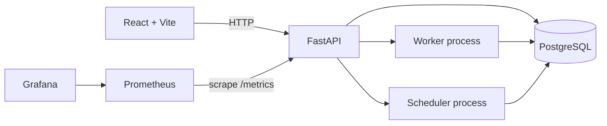

# DriftWatch

DriftWatch is a local-first, cloud-agnostic platform for detecting infrastructure configuration drift. It is designed to run on a developer laptop and does not require cloud credentials.

## Architecture



Compose keeps PostgreSQL on a private internal network. The API joins that network and the application network; browser-facing ports bind to localhost. Worker and scheduler are separate processes. The OpenTofu adapter runs only from the backend code path with argument arrays, timeouts, source-root validation, and refresh-only plans. Phase 3 adds PostgreSQL persistence, Alembic migrations, and versioned project, source, policy, inventory, scan-history, finding, and audit APIs. Phase 4 adds a responsive React dashboard that reads those APIs, summarizes recorded data, supports workspace search, and creates projects. Phase 5 connects manual and scheduled scan queues to the worker, which persists scan outcomes, findings, and finding resolutions. Phase 6 allows operators to publish sanitized finding summaries as GitHub issues. Phase 7 adds an optional read-only Kubernetes manifest adapter.

## Stack

- Backend: Python 3.12, FastAPI, SQLAlchemy, Alembic, Pydantic Settings
- Frontend: React, TypeScript, Vite, Tailwind CSS, Recharts
- Data: PostgreSQL 16
- Observability: Prometheus and Grafana
- Local runtime: Docker Compose

## Start locally

Prerequisites: Docker Desktop or Docker Engine with the Compose plugin, PowerShell, and a browser. The first startup downloads container images and package dependencies; afterward the demo runs locally. No cloud credentials or paid services are used.

```powershell
.\scripts\setup.ps1
.\scripts\start.ps1
```

Open:

- Dashboard: http://localhost:5173
- API OpenAPI: http://localhost:8000/docs
- API readiness: http://localhost:8000/health/ready
- Prometheus: http://localhost:9090
- Grafana: http://localhost:3000 (credentials from `.env`)

To stop containers while keeping local data, run `.\scripts\cleanup.ps1`. To also delete PostgreSQL and observability data, run `.\scripts\cleanup.ps1 -RemoveData`.

## Phase 2 local drift demo

Prerequisites: OpenTofu 1.13 or compatible, Python 3.12+, and PowerShell. The first `tofu init` downloads the free `hashicorp/local` provider and writes a provider lock file; later scans can run without network access while the provider remains cached.

```powershell
python -m venv .venv
.\.venv\Scripts\python.exe -m pip install -r backend/requirements-dev.txt
.\scripts\demo.ps1 -Python (Resolve-Path '.venv\Scripts\python.exe').Path -Tofu tofu
```

The demo creates the baseline file with one explicit `tofu apply`, runs a clean scan, edits the file out of band, reports the changed `content` attribute, restores the approved value, and confirms a clean scan. Detection itself runs no `apply`, does not update state, and returns sanitized JSON. Run an individual scan with `python -m driftwatch.scan_cli --source tofu-local` from the repository root. Exit codes are `0` for clean, `2` for drift, and `1` for scan errors. The Phase 2 CLI remains available for direct local scans. The Phase 4 dashboard displays persisted projects, environments, sources, resources, findings, scans, and audit events when available. In Compose, source paths are relative to `demo/`; use `tofu-local` to scan `demo/tofu-local`.

The OpenTofu integration and parser are described in [Drift detection](docs/drift-detection.md). Phase 3 endpoints and later integrations are described in [Database and API](docs/api.md). Kubernetes setup is described in [Kubernetes drift scans](docs/kubernetes.md).

## Repository layout

```text
backend/          FastAPI package, process entrypoints, and tests
frontend/         React + Vite application
observability/    Prometheus and Grafana configuration
scripts/          PowerShell setup, start, and cleanup helpers
docker-compose.yml Local multi-service environment
```

## Development checks

```powershell
python -m pip install -r backend/requirements-dev.txt
python -m pytest backend/tests
python -m ruff check backend
```

Frontend checks, after installing frontend dependencies with `npm install` from `frontend/`:

```powershell
npm run lint
npm run build
```

## Automated verification and diagnostics

Run the Phase 1-7 checks with one command. The script runs backend tests/lint, frontend lint/build when dependencies are installed, validates Compose configuration, and checks service health when the stack is running. It prints a suggested fix for failures and exits nonzero if any check fails.

```powershell
.\scripts\verify.ps1
```

Select one phase, start the Compose stack as part of verification, or save a JSON report. `-StartServices` reuses existing images; add `-BuildServices` only when you want Docker to rebuild them:

```powershell
.\scripts\verify.ps1 -Phase 1 -StartServices -ReportPath reports/phase1.json
.\scripts\verify.ps1 -Phase 1 -StartServices -BuildServices
.\scripts\verify.ps1 -Phase 2
.\scripts\verify.ps1 -Phase 3
.\scripts\verify.ps1 -Phase 5
.\scripts\verify.ps1 -Phase 6
.\scripts\verify.ps1 -Phase 7
```

Run the full Phase 2 clean → drift → clean demo with `-RunDriftDemo`. This initializes and applies the demo's local baseline; each scan verifies that it leaves the OpenTofu state file unchanged.

```powershell
.\scripts\verify.ps1 -Phase 2 -RunDriftDemo -Python .\.venv\Scripts\python.exe -Tofu tofu
```

## Roadmap

1. Foundation and Docker Compose
2. OpenTofu drift detection engine and offline local demonstration
3. Database schema, migrations, and versioned API
4. React dashboard
5. Worker and scheduler automation
6. GitHub integration
7. Optional Kubernetes adapter (current)
8. Security and production hardening

Each phase will be reviewed before the next begins.
