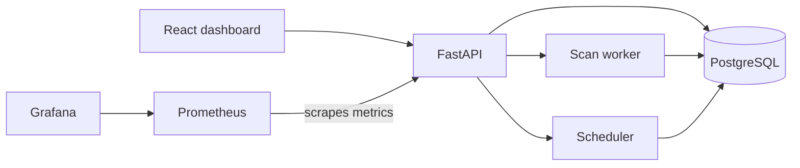

# DriftWatch

DriftWatch detects changes between declared infrastructure and its observed state. It provides a web dashboard, an authenticated REST API, background scan workers, and scan history for local development and self-hosted use.

The OpenTofu scanner uses refresh-only plans and does not apply infrastructure changes. Kubernetes scanning is read-only. Remediation proposals are review records: approving a proposal does not execute a change.

## Features

- OpenTofu drift detection and resource inventory
- Optional read-only Kubernetes manifest scanning
- Projects, environments, infrastructure sources, scans, findings, and audit history
- Background workers and scheduled scans
- Dashboard notifications and human-reviewed remediation proposals
- Optional GitHub issue creation for findings
- Prometheus metrics and a provisioned Grafana dashboard

## Architecture



Docker Compose runs the application services. PostgreSQL is available only on the internal Compose network. The dashboard and API ports bind to localhost by default.

## Requirements

- Docker Desktop or Docker Engine with the Compose plugin
- PowerShell 7 or Windows PowerShell
- A modern browser

The standalone OpenTofu demo also requires Python 3.12 or later and OpenTofu 1.13 or a compatible version.

## Start the application

From the repository root, run:

```powershell
.\scripts\setup.ps1
.\scripts\start.ps1
```

The setup script creates `.env` from `.env.example` if needed and validates the Compose configuration. The start script builds and starts the services.

Open:

- Dashboard: <http://localhost:5173>
- API documentation: <http://localhost:8000/docs>
- API readiness: <http://localhost:8000/health/ready>
- Prometheus: <http://localhost:9090>
- Grafana: <http://localhost:3000>

On first use, create the administrator account from the dashboard. The account setup is available only until the first administrator is created. Sign in with that account on later visits.

The sample `.env` values are for local development. Before exposing the application beyond your machine, set a unique `DRIFTWATCH_JWT_SECRET` and replace default service credentials. See [Security and deployment hardening](docs/security.md).

To stop the services and keep database data:

```powershell
.\scripts\cleanup.ps1
```

To also remove PostgreSQL and observability data:

```powershell
.\scripts\cleanup.ps1 -RemoveData
```

## Create a project and run a scan

1. Sign in to the dashboard and create a project.
2. Open the API documentation at <http://localhost:8000/docs> and authorize with a bearer token. Use `POST /api/v1/auth/token` to sign in and copy the returned `access_token` into Swagger's **Authorize** dialog.
3. Create an environment with `POST /api/v1/projects/{project_id}/environments`. Get the project ID from `GET /api/v1/projects`.
4. Create an infrastructure source with `POST /api/v1/environments/{environment_id}/sources`. Get the environment ID from the create response or `GET /api/v1/projects/{project_id}/environments`.
5. Request a scan with `POST /api/v1/sources/{source_id}/scans`. The endpoint returns `202 Accepted` when the scan is queued. Get the source ID from the create response or `GET /api/v1/environments/{environment_id}/sources`.
6. Check scan progress and results in the dashboard or through the scan, resource, and finding endpoints in the API documentation.

For an OpenTofu source running through Docker Compose, use the path relative to `demo/`, such as `tofu-local`. The worker mounts that directory as its source root.

## Run the local drift demonstration

The standalone demonstration initializes a local OpenTofu example, applies its baseline once, runs a clean scan, changes a local file to produce drift, restores it, and runs a final clean scan. The scans use refresh-only plans and do not apply changes.

```powershell
python -m venv .venv
.\.venv\Scripts\python.exe -m pip install -r backend/requirements-dev.txt
.\scripts\demo.ps1 -Python (Resolve-Path '.venv\Scripts\python.exe').Path -Tofu tofu
```

An individual local scan can be run from the repository root:

```powershell
python -m driftwatch.scan_cli --source tofu-local
```

Exit codes are `0` for clean, `2` for detected drift, and `1` for a scan error. See [Drift detection](docs/drift-detection.md) for adapter details.

## Development

Backend dependencies and checks:

```powershell
python -m pip install -r backend/requirements-dev.txt
python -m pytest backend/tests
python -m ruff check backend
```

Frontend checks, after installing dependencies from `frontend/`:

```powershell
cd frontend
npm install
npm run lint
npm run build
```

The repository verification script runs checks for all phases or a selected phase. It can optionally start Compose services and save a JSON report. Use `-BuildServices` when rebuilding images:

```powershell
.\scripts\verify.ps1
.\scripts\verify.ps1 -Phase 10
.\scripts\verify.ps1 -Phase 1 -StartServices -BuildServices
```

The Phase 2 end-to-end demonstration initializes and applies its local baseline before checking clean, drift, and clean results:

```powershell
.\scripts\verify.ps1 -Phase 2 -RunDriftDemo -Python .\.venv\Scripts\python.exe -Tofu tofu
```

## Documentation

- [API and database](docs/api.md)
- [Drift detection](docs/drift-detection.md)
- [Kubernetes scanning](docs/kubernetes.md)
- [Security and deployment hardening](docs/security.md)

## Repository layout

```text
backend/          FastAPI application, worker, scheduler, and tests
frontend/         React and Vite dashboard
demo/             Local OpenTofu example and scan inputs
observability/    Prometheus and Grafana configuration
scripts/          PowerShell setup, start, cleanup, and verification scripts
docker-compose.yml Compose services for local development
```
