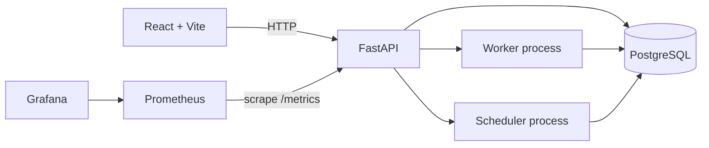

# DriftWatch

DriftWatch is a local-first, cloud-agnostic platform for detecting infrastructure configuration drift. It is designed to run on a developer laptop and does not require cloud credentials.

## Phase 1 architecture



Compose keeps PostgreSQL on a private internal network. The API joins that network and the application network; browser-facing ports bind to localhost. Worker and scheduler are separate processes. In this foundation phase they only provide controlled process entrypoints; scan execution and scheduled scan behavior are added in later phases.

## Stack

- Backend: Python 3.12, FastAPI, SQLAlchemy, Alembic, Pydantic Settings
- Frontend: React, TypeScript, Vite, Tailwind CSS, Recharts
- Data: PostgreSQL 16
- Observability: Prometheus and Grafana
- Local runtime: Docker Compose

## Start locally

Prerequisites: Docker Desktop or Docker Engine with the Compose plugin, PowerShell, and a browser. The first startup downloads container images and package dependencies; afterward the demo runs locally. No cloud credentials or paid services are used.

```powershell
.\scripts\setup.ps1
.\scripts\start.ps1
```

Open:

- Dashboard shell: http://localhost:5173
- API OpenAPI: http://localhost:8000/docs
- API readiness: http://localhost:8000/health/ready
- Prometheus: http://localhost:9090
- Grafana: http://localhost:3000 (credentials from `.env`)

To stop containers while keeping local data, run `.scripts\cleanup.ps1`. To also delete PostgreSQL and observability data, run `.scripts\cleanup.ps1 -RemoveData`.

## Repository layout

```text
backend/          FastAPI package, process entrypoints, and tests
frontend/         React + Vite application
observability/    Prometheus and Grafana configuration
scripts/          PowerShell setup, start, and cleanup helpers
docker-compose.yml Local multi-service environment
```

## Development checks

```powershell
python -m pip install -r backend/requirements-dev.txt
python -m pytest backend/tests
python -m ruff check backend
```

Frontend checks, after installing frontend dependencies with `npm install` from `frontend/`:

```powershell
npm run lint
npm run build
```

## Roadmap

1. Foundation and Docker Compose (current)
2. OpenTofu drift detection engine and offline local demonstration
3. Database schema, migrations, and versioned API
4. React dashboard
5. Worker and scheduler automation
6. GitHub integration
7. Optional Kubernetes adapter
8. Security and production hardening

Each phase will be reviewed before the next begins.
